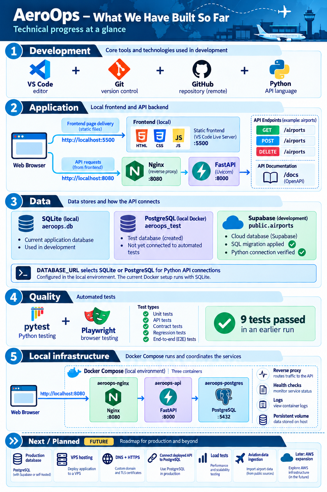

# AeroOps



AeroOps is an educational platform for exploring and analyzing global aviation data. The project is being developed step by step, starting locally and preparing for deployment on a VPS and possible expansion to AWS.

## Current status

The current application includes:

- A FastAPI backend for listing, creating, and deleting airports.
- A web interface built with HTML, CSS, and JavaScript.
- Data validation through the API's airport model.
- SQLite for local development.
- A PostgreSQL development database on Supabase.
- A separate PostgreSQL test database in local Docker.
- A versioned SQL migration for the `airports` table.
- Automated tests with pytest and Playwright.
- OpenAPI documentation at `/docs`, `/redoc`, and `/openapi.json`.
- API and database health endpoints, request logs, and basic measurements.
- Docker Compose services for the API, Nginx, and local PostgreSQL.

The Docker Compose API is connected to Supabase PostgreSQL; listing, creating, and deleting airports were verified. The separate local PostgreSQL database `aeroops_test` was used in a manual run of eight non-browser tests. The default local test run and browser E2E test use SQLite.

## Goal

Build a web dashboard for consulting, visualizing, and analyzing public aviation data worldwide without requiring paid data APIs.

The planned capabilities include airport and runway information, aircraft data imports, historical positions and trajectories, maps, charts, indicators by country and airport, and periodic data updates.

## Current architecture

```text
Browser
├── Frontend served locally on port 5500
└── Nginx on localhost:8080
    └── FastAPI on port 8000
        └── SQLite in a persistent Docker volume
```
The backend can also connect to Supabase PostgreSQL when DATABASE_URL is set in its environment. Without DATABASE_URL, it uses SQLite.

## API

- GET / — confirms that the API is running.
- GET /health — checks the API.
- GET /health/database — checks the database connection.
- GET /airports — lists airports.
- POST /airports — creates an airport.
- DELETE /airports/{airport_id} — deletes an airport.

## Data sources to evaluate

- OurAirports.
- OpenSky Network, within its free-use limits.
- Open-Meteo.
- Other public sources compatible with the project.
These sources are part of the plan; they have not yet been integrated.

## Product indicators

- Total airports stored.
- Airport list requests.
- Airports created and deleted.
- Validation errors.
- Dashboard visits.
- Countries represented.
- Date of the latest data update.
These indicators describe the product measurement plan. Their implementation and reporting will evolve with the application.

## Planned infrastructure

- A production database separate from development and testing.
- Deployment on a Hostinger VPS with Ubuntu and Docker Compose.
- A public domain, DNS, HTTPS, and firewall rules.
- External backups, monitoring, and recovery procedures.
- Possible migration to AWS as the project grows.

## Scope and limitations

AeroOps is an educational and analytical project. It is not an aircraft control system, a certified aviation safety system, or a substitute for official flight information. Its data must not be used as the sole basis for real-world flight, navigation, or operational safety decisions.

Real-time aircraft tracking and paid data APIs are not requirements for the initial version. Apart from the planned VPS, the project aims to use free software and data sources.