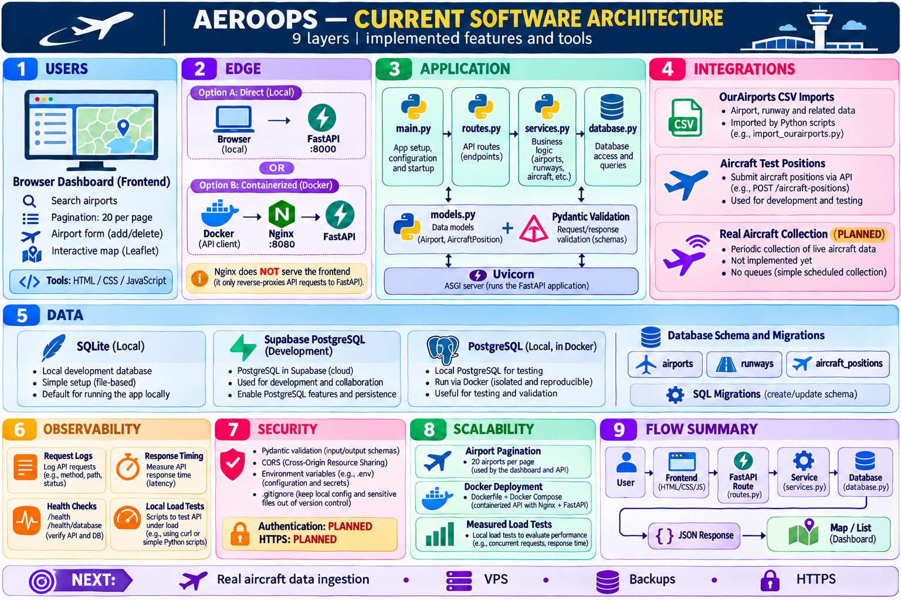

# AeroOps

**Aviation Data Platform | Backend Engineering & Software Architecture**

AeroOps is an educational web platform for exploring public aviation data. It combines an API, a browser dashboard, databases, data imports, automated tests, and local container infrastructure.

**Status:** Functional MVP under active development. The application runs locally; VPS deployment is planned.

## What works today

- Register, search, list, and delete airports.
- Browse airports in pages of 20 results.
- View airports and runways on an interactive Leaflet map.
- View airport, country, and runway totals.
- Store aircraft positions, show the latest recorded position, and draw a historical trajectory.
- Import airport and runway data from OurAirports CSV files.
- Run the API with SQLite or PostgreSQL, selected through `DATABASE_URL`.
- Check API and database health and record request logs and response times.
- Run automated tests and local load tests.

The aircraft positions currently shown on the map are **manually submitted test data**. AeroOps does not yet collect live aircraft positions. In the AeroOps Supabase development project, 80 airports and 111 runways have been imported; 104 runways have coordinates for both ends.

The pagination milestone passed 17 automated tests, including a browser E2E test. The aircraft module has been verified manually through the API and dashboard; its automated tests are still planned.

## Architecture at a glance

The nine layers below show the components implemented so far. Items marked as planned in the image are not part of the current application.



## Project structure

```text
aeroops/
├── backend/                                  FastAPI application
│   ├── __init__.py                           Marks backend as a Python package
│   ├── main.py                               App setup, middleware, and health routes
│   ├── routes.py                             Airport, runway, and aircraft endpoints
│   ├── models.py                             Airport and aircraft-position validation
│   ├── services.py                           Application operations and database queries
│   ├── database.py                           SQLite or PostgreSQL connection and local tables
│   └── config.py                             Settings read from environment variables
│
├── frontend/                                 Browser dashboard
│   ├── index.html                            Page structure and forms
│   ├── style.css                             Colours and layout
│   └── app.js                                API calls, pagination, and Leaflet interactions
│
├── tests/                                    Automated tests
│   ├── test_api.py                           API behaviour, search, and pagination
│   ├── test_models.py                        Model validation
│   ├── test_contract.py                      OpenAPI route contract
│   ├── test_regression.py                    Existing routes
│   └── test_e2e.py                           Real-browser workflow
│
├── scripts/                                  Imports and local performance tools
│   ├── import_airports.py                    Imports airports from CSV
│   ├── import_runways.py                     Imports runways and endpoint coordinates
│   ├── load_test.py                          Request load test
│   └── load_test_pooled.py                   Load test with reused connections
│
├── data/                                     Source aviation data
│   ├── airports.csv
│   └── runways.csv
│
├── supabase/                                 Supabase configuration and migrations
│   ├── config.toml
│   └── migrations/
│       ├── 20261023000000_create_airports.sql
│       ├── 20261111000000_create_runways.sql
│       ├── 20261111010000_add_runway_coordinates.sql
│       └── 20261113000000_create_aircraft_positions.sql
│
├── nginx/
│   └── nginx.conf                            API reverse proxy configuration
│
├── docs/
│   ├── aeroops-architecture-layers.png       Nine-layer architecture infographic
│   ├── aeroops-overview-2026.png             Local and Docker architecture infographic
│   └── load-test-results.md                  Recorded local performance results
│
├── Dockerfile                                Builds the API image
├── docker-compose.yml                        Defines local containers and volumes
├── requirements.txt                          Runtime Python dependencies
├── .env.example                              Example environment settings
├── .gitignore                                Git ignore rules
├── aeroops.code-workspace                    VS Code workspace settings
└── README.md                                 Project overview and decisions
```

The local `.env`, `aeroops.db`, `.venv/`, `.vscode/`, and `.git/` may also exist on a developer's computer. They are not application files to publish in the repository.

## API

| Method | Endpoint | Purpose |
|---|---|---|
| GET | `/` | Confirm that the API is running |
| GET | `/health` | Check the API |
| GET | `/health/database` | Check the database connection |
| GET | `/airports` | Search and paginate airports; returns the page and total |
| POST | `/airports` | Create an airport |
| DELETE | `/airports/{airport_id}` | Delete an airport |
| GET | `/airports/{airport_ident}/runways` | List an airport's runways |
| GET | `/runways/count` | Count stored runways |
| GET | `/countries/count` | Count represented countries |
| POST | `/aircraft/positions` | Store an aircraft position |
| GET | `/aircraft/positions/latest` | Return the latest stored position per aircraft |
| GET | `/aircraft/{icao24}/positions` | Return an aircraft's recorded positions |

For example, `GET /airports?search=DAAE&page=1&limit=20` filters airports and returns the first page. Interactive API documentation is available at `/docs` when the API is running.

## Data and integrations

- **OurAirports — integrated:** Public CSV files supply the airport and runway data imported by the Python scripts.
- **Aircraft positions — test data:** Positions are currently submitted manually through the API. The map displays their latest location and recorded trajectory.
- **OpenSky Network — to evaluate:** Potential source of aircraft positions, subject to access and usage limits.
- **Open-Meteo — to evaluate:** Potential source of weather data.

Imported airport and runway data is a snapshot. Automatic updates have not been implemented.

### Database choices

- Without `DATABASE_URL`, the API uses SQLite. Local tables are created by `backend/database.py`.
- With `DATABASE_URL`, the API connects to PostgreSQL. SQL migrations define the PostgreSQL tables.
- The Docker Compose PostgreSQL service provides the separate `aeroops_test` database for manual testing; the automated suite does not use it by default.

The current aircraft-position example is simulated. The database model does not yet store a `source` field to distinguish simulated and externally collected positions; that is a planned improvement before real data ingestion.

## Quality and operations

The automated suite covers API behaviour, input validation, the OpenAPI contract, regression checks, pagination, and a browser E2E workflow. Automated tests for the new aircraft module are planned.

Local load and stress tests measure request success, failures, and response times. Their results describe the local test environment; they do not establish production VPS capacity. Recorded observations are in [docs/load-test-results.md](docs/load-test-results.md).

The API provides health endpoints, request logs, and basic response-time measurements. Docker Compose defines the API, Nginx, a separate PostgreSQL service, and persistent volumes.

## Architectural decisions

### ADR-001 — Python and FastAPI

**Decision:** Use Python and FastAPI for the backend.

**Why:** This supports the project's educational goal while providing data validation and automatic OpenAPI documentation.

**Trade-off:** Other backend frameworks were not benchmarked against this choice.

**Status:** Implemented.

### ADR-002 — Progressive database architecture

**Decision:** Support SQLite for simple local development and PostgreSQL for remote and container-based experimentation.

**Why:** The same application can be exercised against both a local database file and a PostgreSQL database. `DATABASE_URL` selects PostgreSQL when configured.

**Trade-off:** Supporting two database engines requires attention to SQL differences, migrations, and testing. A remote database also adds network dependency.

**Status:** SQLite, Supabase PostgreSQL, and a separate local PostgreSQL test database have been used. A production database strategy remains to be defined for VPS deployment.

### ADR-003 — Docker Compose and Nginx

**Decision:** Package the API with Docker, coordinate local services with Docker Compose, and use Nginx as a reverse proxy for the containerized API.

**Why:** This provides practical experience with reproducible application packaging and prepares a path toward VPS deployment.

**Trade-off:** Containers and the proxy add operational configuration. The current Nginx setup forwards API traffic only.

**Status:** Implemented locally; VPS deployment is planned.

### ADR-004 — Public aviation datasets

**Decision:** Import airports and runways from OurAirports CSV files using separate Python scripts.

**Why:** The dashboard can use real public aviation data without requiring a paid API. Importing is separate from serving API requests.

**Trade-off:** The data can become outdated, updates require rerunning the scripts, and the current import is a limited sample.

**Status:** Implemented for airports and runways; scheduled imports are planned.

### ADR-005 — Paginated airport search

**Decision:** Filter airports in the API and return a limited page of results together with the total count.

**Why:** The dashboard can browse larger datasets without downloading every airport in each list request.

**Trade-off:** The frontend must manage the current page, and product totals need their own complete counts rather than using only the visible page.

**Status:** Implemented and tested.

### ADR-006 — Historical aircraft positions

**Decision:** Store positions with an aircraft identifier, coordinates, and observation time; expose both the latest position and the recorded history.

**Why:** This supports map markers and trajectories even when position data arrives with a delay.

**Trade-off:** Large histories will require retention rules, indexes, and performance testing. The current manually submitted sample must not be presented as live aircraft data.

**Status:** Basic API, storage, and map trajectory implemented with test data. Automated tests and real data ingestion are planned.

## Next steps

- Add automated tests for aircraft-position creation and queries.
- Record whether each aircraft position is simulated or obtained from an external source.
- Evaluate a public aircraft-position source and implement controlled, periodic ingestion.
- Expand analytics and improve the dashboard layout.
- Define capacity targets and test with representative datasets and traffic.
- Plan VPS deployment with a production database, HTTPS, backups, monitoring, and recovery.
- Evaluate AWS expansion only when the project has a reason to move beyond the VPS.

## Scope and limitations

AeroOps is an educational and analytical project. It is not a certified aviation safety system or a substitute for official flight information. Its data must not be used as the sole basis for flight, navigation, or operational safety decisions.

Real-time aircraft tracking and paid data APIs are not requirements for the initial version. Apart from a future VPS, the project aims to use free software and suitable public data sources.